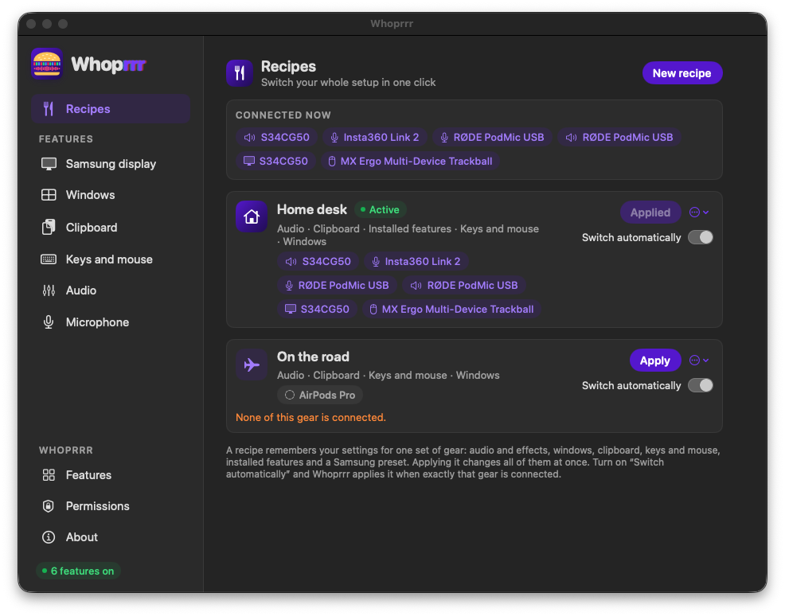
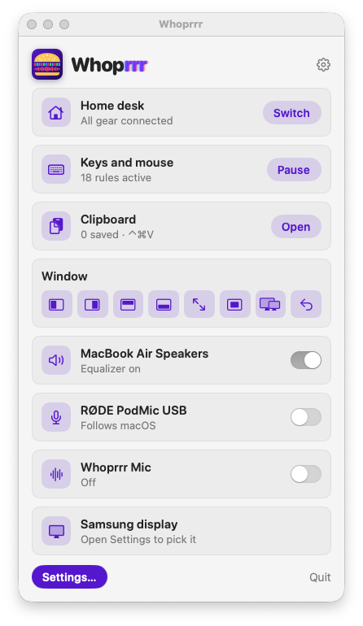
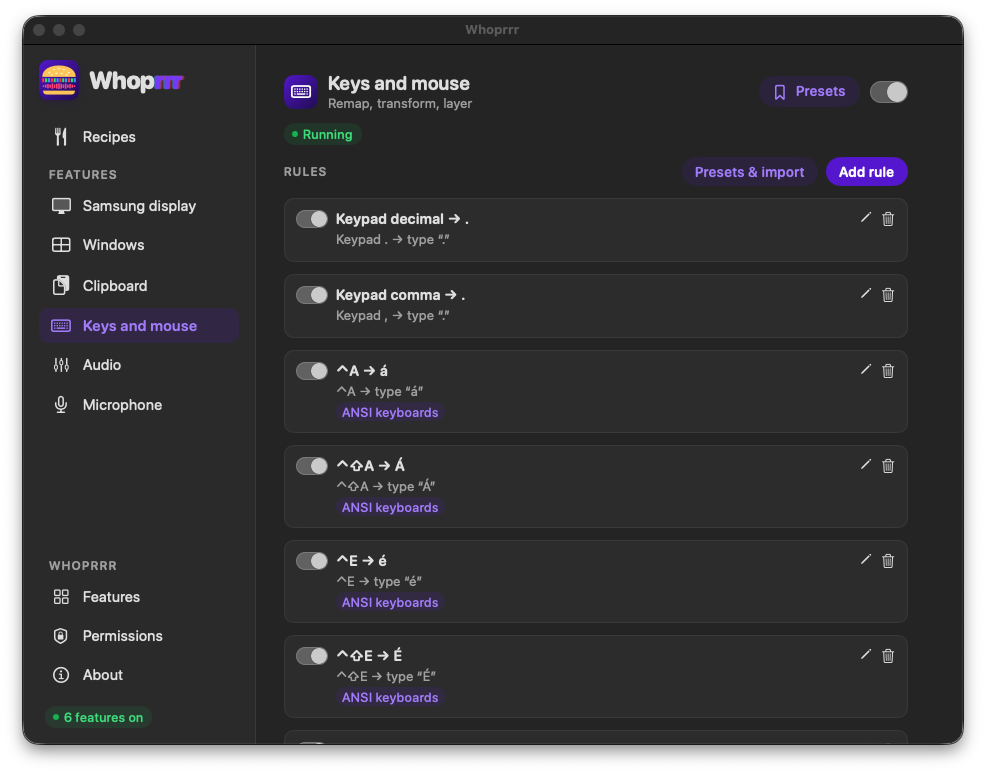
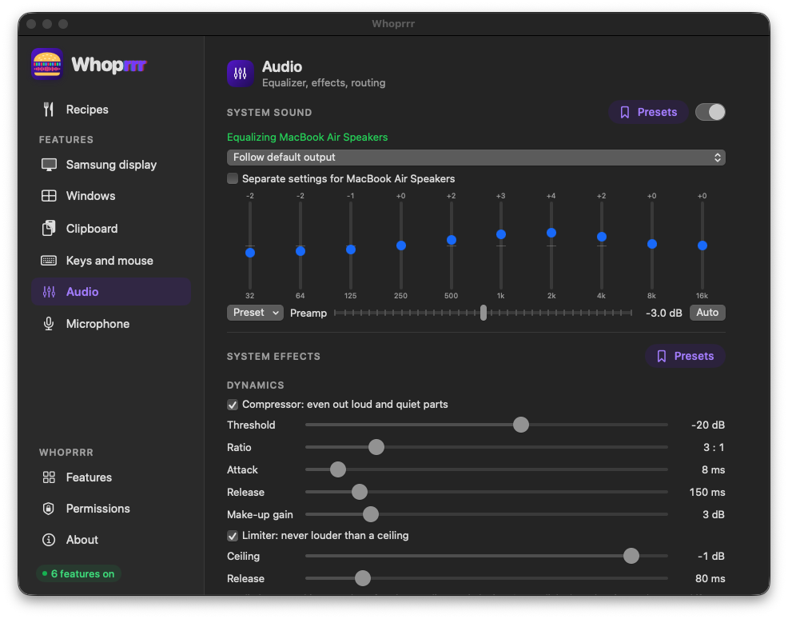
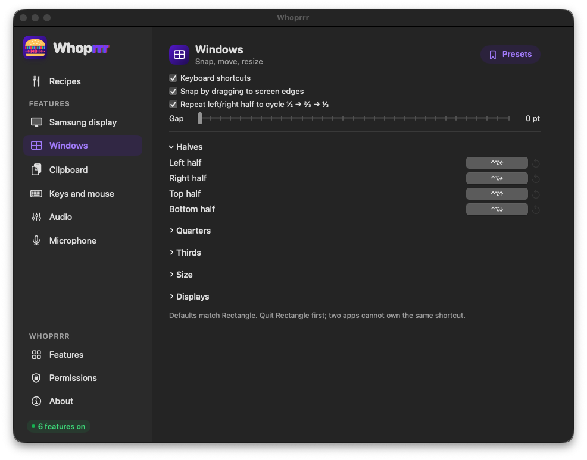
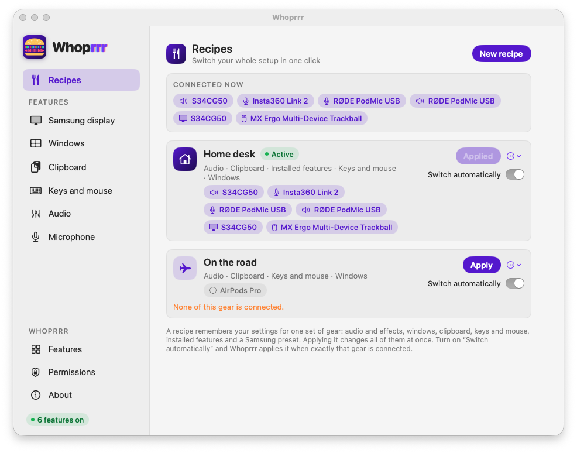

<p align="center"></p>

<h1 align="center">Whoprrr</h1>
<p align="center"><b>Your Mac, stacked your way.</b><br>One menu-bar app for window snapping, a clipboard manager, key and mouse remapping, system-wide audio effects, a virtual mic, and Samsung display control. Switch the whole setup with one click when your gear changes.</p>

> **Public beta.** Whoprrr changes real things on your Mac (display brightness over DDC, key and mouse events, system audio).
> Read [Known issues](docs/known-issues.md) and keep **⌃⌥⇧⌘⎋** (emergency off) in mind. Builds are not yet notarized by Apple: see [Install](docs/install.md).

<p align="center">
  <br>
  
  
</p>

<details><summary>More screenshots</summary>

<p align="center">
  <br>
  <br>
  
</p>
Screenshots use sample data (<code>scripts/screenshots.sh</code>).
</details>

## What it does

| | |
|---|---|
| **Recipes** | Save your settings for a set of gear (home desk, on the road) and apply them in one click, or automatically when the gear is connected. |
| **Windows** | Rectangle-compatible shortcuts: halves, quarters, thirds, cycling, gaps, drag-to-edge snapping, restore, move between displays. |
| **Clipboard** | Searchable history with pins and snippets, images and files, plain-text paste. Skips password-manager copies, per-app ignore list. |
| **Keys and mouse** | Remap keys and mouse buttons, tap-vs-hold, Hyper key, layers, per-app and per-keyboard rules, type text or key sequences (numpad decimal, accents), Logitech button support, Mission Control and other system actions, import from Karabiner. |
| **Audio** | System-wide equalizer per output device with no driver, compressor and limiter, Audio Unit plugins on the output, mic pinning, Bluetooth keep-alive so speakers do not power off. |
| **Microphone** | A virtual "Whoprrr Mic" that runs your real mic through gain, gate, compressor, equalizer and Audio Unit plugins, so *every* app gets the processed sound. |
| **External displays** | Finds monitors that answer DDC/CI and picks yours automatically: brightness, contrast and RGB with verified writes and presets, plus camera-assisted matching against the MacBook screen. |
| **Presets** | Every settings panel can save and restore its own presets. |

Each feature is a module you can switch off on the Features page. A switched-off feature does not load and never asks for permissions.

## Requirements

- macOS 14.2 or newer (the system equalizer uses Core Audio process taps).
- Apple Silicon for display control (it talks to the display through Apple Silicon's display interface).
- Nothing else. No kernel extensions and no accounts. The app goes online for the daily update check, to activate your key once, and to refresh its pass about once a week (see [Privacy](#privacy)).

## Get it

The source code is free under the MIT licence: read it, change it, [build it yourself](#build-from-source). Note that the app asks for a key on first launch, including one built with `scripts/build-app.sh`; only debug builds (`swift build`) skip the key check, for development. The ready build, its updates and help cost **$5, once**, at [whoprrr.app](https://whoprrr.app) (beta price). You get a key and a personal downloads page there.

## Install

1. Download the zip from your personal downloads page at [whoprrr.app](https://whoprrr.app), unpack it and drag **Whoprrr** to Applications. 
2. Because beta builds are not notarized yet, macOS will not open it straight away. Double-click it once, then open **System Settings → Privacy & Security**, scroll down and press **Open Anyway**; or run `xattr -dr com.apple.quarantine /Applications/Whoprrr.app`. Step by step: [docs/install.md](docs/install.md).
3. The ready build asks for your key the first time it opens. Then open **Whoprrr** from the menu bar → **Settings…** → **Permissions** and grant what the features you use need. [What each permission is for](docs/permissions.md).
4. Optional: **Microphone → Install** adds the Whoprrr Mic virtual device (asks for your administrator password once).

Uninstall with `scripts/uninstall.sh` or see [docs/uninstall.md](docs/uninstall.md).

## Privacy

Your settings, clipboard history and audio stay on your Mac. No analytics and no accounts. The app contacts whoprrr.app for three things: the daily update check (you can turn it off), activating your key once (it sends the key, an id for this Mac, the Mac's name and model, and the app version), and a refresh of its pass about once a week. A fit report is sent only if you press Send. Clipboard history is stored locally and password-manager copies are skipped. Audio is processed live and never recorded. Details: [PRIVACY.md](PRIVACY.md).

## Safety

- **Keys and mouse:** a key is only intercepted if a rule matches it. Everything held is released when remapping stops, and **⌃⌥⇧⌘⎋** pauses every rule. Remaps made with `hidutil` (Caps Lock) are removed when Whoprrr quits.
- **Display:** writes go only to an external display you chose, never the built-in screen. Every write is read back and verified. Presets never apply by themselves.
- **System audio:** the equalizer does not mute your sound until real audio has proven the capture permission works, so a missing permission cannot silence you.
- **Logitech:** buttons are taken over only while a rule uses them and are released on quit.

## Compatibility and honesty

Whoprrr was developed on one reference setup (MacBook Air M1, Samsung S34CG50, Logitech MX Keys S and MX Ergo, RØDE PodMic USB). Other hardware may work or may not; that is what the beta is for. Please [report](../../issues/new/choose) what you find. It uses a few private macOS interfaces (DDC transport, Mission Control), so it cannot be on the Mac App Store and a macOS update can break parts of it. See [docs/compatibility.md](docs/compatibility.md).

## Build from source

```sh
git clone https://github.com/ticodb/whoprrr.git && cd whoprrr
swift test                      # unit tests for every module (no hardware is touched)
./scripts/build-app.sh          # build/Whoprrr.app, ad-hoc signed unless you made a local identity
open build/Whoprrr.app
```

More in [docs/building.md](docs/building.md). Architecture: [docs/architecture.md](docs/architecture.md).

## Contributing

Bug reports, hardware reports and pull requests are welcome: see [CONTRIBUTING.md](CONTRIBUTING.md). One rule matters a lot here: **do not copy code from GPL projects** (Solaar, Vorssaint, BlackHole…), so Whoprrr can stay MIT.

## License and credits

MIT licensed: see [LICENSE](LICENSE). Third-party code: [THIRD_PARTY_LICENSES.md](THIRD_PARTY_LICENSES.md). Thanks and credits: [ACKNOWLEDGMENTS.md](ACKNOWLEDGMENTS.md). Brand and logo: [docs/brand/brand-manual.html](docs/brand/brand-manual.html).

Whoprrr is an independent project, not affiliated with Apple, Samsung, Logitech, RØDE or any other company mentioned.
